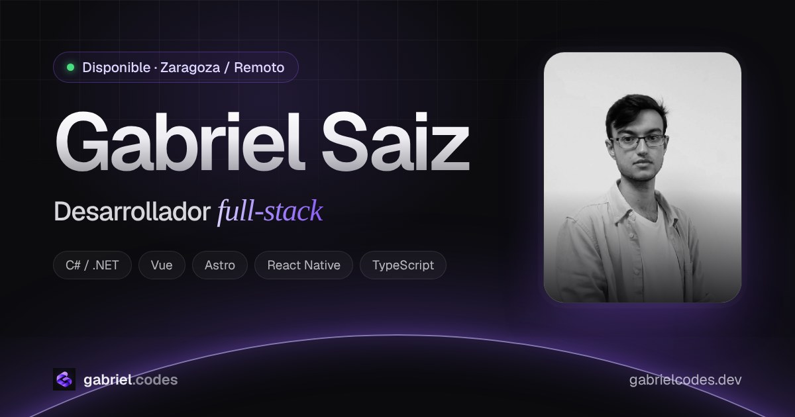

<div align="center">

<a href="https://gabrielcodes.dev"></a>

# gabrielcodes.dev

**El portfolio de Gabriel Saiz, desarrollador full-stack.**<br>
C# y .NET en el backend · Vue y Astro en la web · React Native en el móvil.

[](https://pagespeed.web.dev/analysis?url=https%3A%2F%2Fgabrielcodes.dev)
[](https://astro.build)
[](https://www.typescriptlang.org)
[](https://tailwindcss.com)

[**Ver la web →**](https://gabrielcodes.dev) &nbsp;·&nbsp; [LinkedIn](https://www.linkedin.com/in/gabriel-saiz-de-la-maza-bajo-140370184/) &nbsp;·&nbsp; [Descargar CV](https://gabrielcodes.dev/cv/Gabriel-Saiz-CV.pdf) &nbsp;·&nbsp; [Contacto](https://gabrielcodes.dev/#contacto)

</div>

---

## La idea

Un portfolio no debería limitarse a decir que sabes hacer webs rápidas, accesibles y cuidadas: **debería serlo**. Esta web es la primera pieza del portfolio. Es estática, pesa poco, carga al instante en un móvil de gama media y aun así tiene personalidad: scroll con inercia, titulares que se revelan palabra a palabra, haces de luz, tarjetas que se apilan y un minijuego escondido con ranking global.

Todo lo que cuenta es verificable: las apps están en las stores y las webs, online.

## Lo que hay en producción

| Proyecto | Qué es | Stack | |
| --- | --- | --- | --- |
| **ARCH** | App iOS de comunidad para Oxford University: chat en tiempo real, entradas en Apple Wallet, pagos y suscripciones, panel de moderación | React Native · Expo · .NET · PostgreSQL · SignalR · Stripe · AWS | [App Store](https://apps.apple.com/us/app/the-arch/id6753820007) |
| **Huvegrym** | Web de una escuela de danza, con el SEO y el rendimiento cuidados | HTML · CSS · JavaScript | [huvegrym.es](https://huvegrym.es) |
| **Tarot Divinidad** | Web de consultas con reservas | Astro · Calendly · Google Calendar · WhatsApp | [divinidad000.com](https://divinidad000.com) |
| **4 apps con Deveco.it** | Publicación en App Store y Google Play con CI/CD automático | React Native · Flutter · Expo EAS · Codemagic | [deveco.it](https://deveco.it/es/) |
| **BUG RUN** | El minijuego escondido en esta web, con ranking global | TypeScript · Canvas · PHP · MySQL | [Konami ↓](#-bug-run) |

## Diseño

Oscuro y premium, con **un único acento violeta**, el de la marca, que aparece como luz y no como relleno: halos, el borde de un horizonte iluminado y los haces del hub de tecnologías.

<p>


</p>

- **Tipografía:** Geist variable para todo y Instrument Serif en cursiva solo para la palabra clave de cada titular. Las dos van autoalojadas y recortadas a latín.
- **Piezas con carácter:**
  - Nombre gigante con brillo metálico sobre un horizonte que se ilumina como un eclipse.
  - Hub del stack con la marca en el centro y haces de luz recorriendo las conexiones.
  - Proyectos que se apilan al hacer scroll.
  - Línea de tiempo con un raíl que se llena.
  - Bento de "Sobre mí" con la hora de Zaragoza en directo.
- **Mobile first de verdad:**
  - Cada sección se diseña primero a 360 px.
  - Menú a pantalla completa y scroll nativo en táctil, que gasta menos batería que uno simulado.
  - Ni un píxel de scroll horizontal.

## Rendimiento: 100 sin trucos

Lighthouse móvil da **100 / 100 / 100 / 100** en español y en inglés, con **CLS 0** y LCP por debajo de 2 s en la simulación 4G. Las decisiones que lo hacen posible:

| Decisión | Por qué |
| --- | --- |
| **HTML estático con Astro** y cero frameworks en el cliente | El navegador recibe documentos, no una aplicación que haya que arrancar |
| **CSS inline** en cada página | No hay petición bloqueante antes del primer pintado |
| **Fuentes locales con `preload`** y subset latino | Sin saltos de tipografía ni DNS de terceros |
| **Imágenes AVIF/WebP responsive** generadas en el build | Cada pantalla descarga solo el tamaño que necesita |
| **Lenis cargado bajo demanda**, solo con ratón o trackpad | El scroll suave no cuesta nada en móvil, donde no aporta |
| **Inicialización en `requestIdleCallback`** de lo que no es crítico | El hilo principal queda libre para la primera interacción |
| **`content-visibility: auto`** en secciones bajo el pliegue | El navegador no maqueta lo que aún no se ve |
| **Lecturas del DOM agrupadas en un único `requestAnimationFrame`** | Sin *forced reflows* al hacer scroll |
| **Animaciones solo de `transform` y `opacity`** | Se componen en la GPU, sin repintar |
| **El juego se descarga al abrirlo**, nunca antes | Un easter egg no puede penalizar a quien no lo busca |

## Accesibilidad

- HTML semántico, enlace "Saltar al contenido" y foco visible en todo.
- Contraste AA como mínimo, también en los textos secundarios.
- Con **"reducir movimiento"** activado, todo se ve igual, sin animaciones.
- **Sin JavaScript** la web funciona igual: el contenido es visible y el formulario se envía con un POST normal.
- Menú móvil con `inert`, cierre con Escape y bloqueo de scroll.
- Los titulares partidos en palabras mantienen el texto completo para los lectores de pantalla.

## SEO y datos

- Español e inglés por ruta (`/` y `/en`), con `hreflang`, canonical e imagen social propia para cada idioma.
- **JSON-LD:** `ProfilePage` + `Person` (formación, idiomas, CV), `WebSite` y migas de pan.
- `sitemap.xml` con `lastmod`, `robots.txt` y versiones en **markdown para agentes de IA** (`/index.md`, `/en.md`, `/llms.txt`).
- **Analítica sin cookies con [Umami](https://umami.is):**
  - No hace falta banner de consentimiento.
  - Se carga después del `load`, para no competir con el primer pintado.
  - Solo cuenta eventos útiles: descargas del CV, clics a LinkedIn, GitHub y las apps, y envíos del formulario.

## Formulario de contacto sin spam

El formulario no envía a un servicio externo desde el navegador (ese endpoint público acaba en manos de los bots), sino a un endpoint propio en PHP que filtra por capas, de lo más barato a lo más caro:

- **Honeypot:** un campo invisible que solo rellenan los bots. Se les responde "ok" y se descarta en silencio.
- **Validación estricta** en el servidor y rechazo de los mensajes con muchos enlaces.
- **Cloudflare Turnstile verificado en el servidor:** sin un token válido, de un solo uso y emitido para este dominio, no se envía nada. El script solo se carga cuando alguien toca el formulario, así que no cuesta nada en Lighthouse.
- **Límites por IP y globales**, con la IP guardada solo como hash HMAC, que se borra a las 24 horas.
- **Entrega por un endpoint privado**, que solo está en la configuración del servidor y nunca en el HTML.

Además, el email no aparece en claro en ningún HTML: se codifica en el build y lo monta el navegador. El CV público no lleva teléfono.

## 🎮 BUG RUN

Pulsa **↑ ↑ ↓ ↓ ← → ← → B A** en la web, o el botón "Insert coin" del pie. Es un runner en Canvas al estilo del dinosaurio de Chrome: cae la noche, sube la velocidad, aparecen más bugs y hay ranking global.

Por debajo hay más backend del que parece:

- **Tokens de partida de un solo uso.** Una puntuación solo vale si viene de una partida real.
- **Validación en el servidor.** Se rechaza cualquier puntuación imposible para la duración de la partida.
- **Límites por IP y por día**, con la IP guardada solo como hash HMAC y transacciones en MySQL.
- **Migraciones automáticas y filtro de nombres.**
- **Credenciales fuera del repositorio** y fuera de `public_html`.

## En local

Requiere **Node.js 22.12 o superior**, que es lo que pide Astro 7.

```bash
npm install
npm run dev      # http://localhost:4321
npm run build    # web estática en dist/
npm run preview  # sirve el build
npm run check    # tipos (astro check)
```

**Despliegue:** se sube el contenido de `dist/` a `public_html/` en Hostinger, incluidos los `.htaccess` (rutas limpias, caché y markdown para agentes) y `api/scores.php`, que es el ranking. También `api/contact.php`, que es el formulario. El fichero `arcade-config.php`, con las credenciales de la base de datos y la clave secreta de Turnstile, va un nivel por encima de `public_html` y nunca entra en git.

## Contacto

Busco un equipo donde aportar desde el primer día. Estoy en Zaragoza y abierto al remoto.

<div align="center">

[**gabrielcodes.dev**](https://gabrielcodes.dev) · [LinkedIn](https://www.linkedin.com/in/gabriel-saiz-de-la-maza-bajo-140370184/) · [GitHub](https://github.com/GabriLPDA22) · [Formulario de contacto](https://gabrielcodes.dev/#contacto)

<sub>© Gabriel Saiz. Código y contenido propios: todos los derechos reservados.</sub>

</div>
